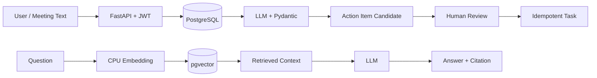

# Meeting Action Assistant

An LLM application / AI backend that turns meeting text into structured action-item candidates, creates tasks after human review, and supports company-knowledge and historical-meeting RAG.

## 1. Overview

Meeting commitments are difficult to track, and model suggestions can be wrong. This application separates AI-generated candidates from approved tasks, preserving ownership, evidence and review state. Knowledge search returns traceable sources and respects meeting access permissions.

## 2. Architecture



## 3. Core Features

- FastAPI backend, JWT authentication and Creator/Owner authorization.
- Meeting CRUD and UTF-8 TXT/Markdown uploads.
- OpenAI-compatible generation and Pydantic structured-output validation.
- Human edit/confirm/reject; revision checks and idempotent task creation.
- LangGraph controlled workflow with a database-backed review boundary.
- Company knowledge and authorized historical-meeting RAG using PostgreSQL + pgvector.
- Reproducible evaluation, Docker Compose and GitHub Actions CI.

## 4. Tech Stack

Python · FastAPI · PostgreSQL · pgvector · SQLAlchemy 2 · Alembic · Pydantic · LangGraph · httpx · pytest · Docker / Docker Compose · GitHub Actions. Embeddings use a fixed multilingual E5 ONNX model on CPU.

## 5. Evaluation

### Action Item Extraction

Small-scale real LLM evaluation on 30 AliMeeting Test1 meetings:

| Meetings | Precision | Recall | F1 |
|---:|---:|---:|---:|
| 30 | 4.79% | 43.66% | 8.64% |

The baseline showed substantial over-extraction / false positives, reinforcing the need for human-in-the-loop safeguards. Two timeout failures count as empty predictions. This is a balanced diagnostic sample, not a population estimate. [Protocol, alignment and metrics](evaluation/evidence/action_item_evaluation.md) · [Sanitized bad cases](evaluation/evidence/action_item_bad_cases.md).

### RAG

| Synthetic questions | Answerable | Hit@5 | Recall@5 | MRR |
|---:|---:|---:|---:|---:|
| 25 | 22 | 1.0 | 1.0 | 0.893939 |

This is a small synthetic retrieval benchmark, not production accuracy. Full-set generation was not evaluated. In an earlier six-question generation check, 5/6 passed; no-answer was 1/2 initially, with the failed empty refusal passing a single-question retest after correction. [Retrieval report](evaluation/evidence/rag_retrieval.json).

## 6. Reliability / Engineering

Connect/read timeouts, bounded retry with exponential backoff, structured logging and request IDs support diagnosis without logging meeting bodies or secrets. Transactions, row locks and a unique source-candidate constraint prevent duplicate tasks. Evidence is reconstructed from validated source-line ranges; citations must reference retrieved material. No-answer behavior is validated separately from retrieval. [Engineering notes](docs/ENGINEERING_NOTES.md).

## 7. Testing

**82 tests passed**, including real PostgreSQL integration tests, authorization, review concurrency, rollback, CPU retrieval and mocked provider-error paths. Tests create isolated local databases and require CREATEDB permission. CI does not call a paid LLM provider.

```sh
uv run pytest -q
uv run python -m scripts.evaluate_rag --output outputs/evaluations/rag_reproduction
```

## 8. Deployment Validation

Ubuntu 24.04 ECS deployment verified Docker Compose, FastAPI, PostgreSQL + pgvector, Alembic migrations, persistent volumes, container restart recovery, full ECS reboot recovery and SSH tunnel access.

Real LLM calls were validated in the local development environment. Cloud deployment validated infrastructure rather than maintaining a permanent public service. The Meeting Assistant cloud deployment was intentionally decommissioned after validation. [Deployment evidence](docs/DEPLOYMENT.md).

## 9. Quick Start

Requires Docker, uv and Python 3.11–3.13. Run from the repository root:

```sh
git clone https://github.com/LeoxfZhou/meeting-assistant.git
cd meeting-assistant
uv sync --frozen
cp .env.example .env  # Do not overwrite an existing configuration.
```

Set a random `POSTGRES_PASSWORD`, matching `DATABASE_URL`, and a random `JWT_SECRET` of at least 32 characters. Set `LLM_API_KEY`, `LLM_BASE_URL`, `LLM_MODEL` for generation; never commit credentials.

```sh
chmod 600 .env
uv run python -m scripts.download_embedding
docker compose up -d --build --wait
uv run pytest -q
```

The API container runs `alembic upgrade head` before startup. Local UI: http://127.0.0.1:8000 ; API docs: http://127.0.0.1:8000/docs . For host-Python development, start PostgreSQL alone with `docker compose up -d --wait postgres`, then run `uv run alembic upgrade head` and `uv run uvicorn app.main:create_app --factory --host 127.0.0.1 --port 18080`.

Registration does not grant Owner privileges. An administrator can promote a registered account with `docker compose exec api python -m scripts.promote_owner --email your-email@example.com`. Owner can ingest bundled synthetic company documents; meetings are indexed explicitly. Retrieval works without a generation key.

## 10. Dataset

AliMeeting4MUG is used only for action-item evaluation, not RAG ingestion. The audit covers 442 meetings, 302,332 sentences and 1,472 action IDs. [Data documentation](data/README.md) · [Public audit summary](evaluation/evidence/data_audit_public.md).

AliMeeting4MUG raw data is not redistributed in this repository. Users should obtain the dataset from its official source and comply with the original dataset license/terms. Existing local materials do not independently verify its source revision or license. Original synthetic company documents are included.

## 11. Limitations

- Action extraction has significant over-extraction and is not production-grade.
- AliMeeting does not provide reliable structured Gold labels for assignee/deadline/task fields.
- RAG evaluation uses a small synthetic dataset; valid citations do not prove semantic correctness.
- Real LLM calls and cloud infrastructure deployment were validated separately.
- Production rate limiting, email verification, HTTPS, ASR/TTS, QLoRA and Multi-Agent are outside the current scope.

## 12. License

Original repository code and synthetic documents: [MIT](LICENSE), Copyright 2026 LeoxfZhou. Third-party datasets, dependencies and model weights retain their respective licenses/terms.
