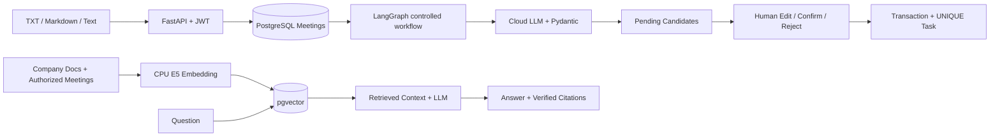

# Meeting Action Assistant / 中文会议行动助手

把会议中的安排变成**可审核、可追踪的任务**：Meeting Text → AI Extraction → Human Review → Task，并支持企业资料与授权历史会议的 RAG。FastAPI / PostgreSQL / LLM Application 求职项目，非商业生产系统。

**Feature frozen / Interview demo**。真实Provider在开发Mac验证；大陆阿里云ECS已完成基础设施部署验收并主动下线。当前抽取效果仍有明显改进空间，以下给出真实小样本结果。

## Architecture



## Core features

- FastAPI、SQLAlchemy2、Alembic，TXT/MD上传、JWT/Argon2与Creator/Owner权限。
- 长会议分段；Pydantic结构化输出；模型返回行号，由服务端重建原文证据。
- 人工编辑/确认/拒绝；revision防过期操作，事务、行锁与唯一来源约束防重复任务。
- LangGraph受控流程与确定性工具调用；审核状态持久化于SQL，不是自由Multi-Agent。
- CPU multilingual E5 + pgvector；权限过滤在Top-K之前，引用支持回查。
- 有限重试、超时、429/5xx分类、request_id、脱敏日志与token记录。
- 真实PostgreSQL测试、数据泄漏处理、评测、Docker/Linux部署及下线证据。

## Real evidence

| Evidence | Measured result | Artifact |
|---|---|---|
| Tests | 82 passed，真实PG/CPU，外部错误路径Mock | [测试](tests/) / GitHub Actions |
| AliMeeting audit | 442场 / 302332句 / 1472 Action IDs / 109空标签 | [公开摘要](evaluation/evidence/data_audit_public.md) |
| Action extraction | 30场未用于调试的Test1；micro P=0.0479、R=0.4366、F1=0.0864（TP=31 / FP=616 / FN=40） | [指标与对齐规则](evaluation/evidence/action_item_evaluation.md) |
| Synthetic retrieval | 22有答案题 Hit@5=1、Recall@5=1、MRR≈0.894 | [25题报告](evaluation/evidence/rag_retrieval.json) |
| Synthetic generation | 历史6题首轮5/6；无答案1/2；修复后单题通过 | [原始口径](evaluation/evidence/synthetic_provider_round1.json) |
| Deployment lifecycle | ECS部署、卷持久化、容器/整机重启、down/up、授权down -v | [部署与下线](docs/DEPLOYMENT.md) |

不使用“RAG accuracy=100%”。检索覆盖和生成正确性是不同指标；没有全25题生成准确率或真实成本收益主张。

## 快速启动

需要 Python 3.11–3.13、uv、Docker。已实测本机 Python 3.13.9；pyproject.toml 为依赖源，uv.lock 锁定版本。

```sh
uv sync --frozen
cp .env.example .env  # 已有 .env 时不要覆盖
```

在 `.env` 设置本机随机 `POSTGRES_PASSWORD`，同步 `DATABASE_URL` 密码部分，并生成至少 32 字符的 `JWT_SECRET`。不要提交或发到聊天。可用 Python `secrets.token_hex(32)` 在本机生成；`chmod 600 .env`。本次开发已经生成随机本地凭据，不需要重置现有文件。

```sh
uv run python -m scripts.download_embedding
docker compose up -d --build --wait
```

访问 [本地演示页面](http://127.0.0.1:8000) 或 [Swagger](http://127.0.0.1:8000/docs)。首次注册不会自动成为 Owner；本地管理员可对自己的已注册账号执行：

```sh
docker compose exec api python -m scripts.promote_owner --email your-email@example.com
```

Owner 可导入 12 份原创虚构企业资料。创建会议后点击“建立检索索引”，可检索自己的历史会议。LLM 未配置时“AI 提取”和“基于依据问答”会明确失败；不能把失败看成空结果。检索本身不需要云 Key。

## 本机 Python 开发方式

```sh
docker compose up -d --wait postgres
uv run alembic upgrade head
uv run alembic check
uv run uvicorn app.main:create_app --factory --host 127.0.0.1 --port 18080 --reload --no-access-log
```

此方式使用 `.env` 中 loopback 数据库 URL；Compose API 会将 URL 主机覆盖为服务名 postgres。所有命令在项目根执行。`/health` 是 liveness，实际数据库可用性要通过 CRUD 验证。

## 配置

| 变量 | 含义 |
|---|---|
| APP_ENV | development / test / production |
| DATABASE_URL | postgresql+psycopg 连接串（不要打印） |
| JWT_SECRET | 至少 32 字符随机签名密钥 |
| JWT_EXPIRE_MINUTES | 默认 60 分钟 |
| LOG_LEVEL | 默认 INFO；SQL 参数和网络调试日志不输出 |
| LLM_API_KEY / LLM_BASE_URL / LLM_MODEL | 云端 Generation；未配置时 503 |
| LLM_TOKEN_LIMIT_PARAMETER / LLM_MAX_COMPLETION_TOKENS | 默认 max_completion_tokens / 4096；旧兼容服务可显式选择 max_tokens |
| LLM_TEMPERATURE | 默认不发送；仅模型支持时设置 |
| LLM_CONNECT_TIMEOUT / LLM_READ_TIMEOUT / LLM_MAX_ATTEMPTS | 默认 5秒 / 30秒 / 3次 |
| POSTGRES_USER / POSTGRES_PASSWORD / POSTGRES_DB / POSTGRES_PORT | Compose 数据库配置；默认本机端口 55432 |

Provider 须支持 HTTPS 下的 OpenAI-compatible `/chat/completions` 与 JSON object 输出。不同兼容服务的支持程度需真实联调。模型名和定价未指定，不估造成本。

## 当前 API

除 `/`、`/health`、注册/登录、API 文档外，业务接口需要 Bearer JWT。

| 范围 | 接口 |
|---|---|
| 用户 | POST /auth/register、POST /auth/login、GET /auth/me、GET /users（绑定负责人目录） |
| 会议 | POST/GET /meetings、GET/PATCH/DELETE /meetings/{id}、POST /meetings/upload |
| 提取/流程 | POST /meetings/{id}/extract、POST /meetings/{id}/workflow、GET /workflow/tools |
| 候选 | GET /meetings/{id}/candidates、PATCH /candidates/{id}、POST /candidates/{id}/confirm 或 reject |
| 任务 | GET /tasks、GET /tasks/my、GET/PATCH /tasks/{id} |
| 知识 | POST /knowledge/company/ingest（Owner）、POST /meetings/{id}/index |
| 检索/问答 | POST /knowledge/search、POST /knowledge/ask |
| 引用 | GET /knowledge/chunks/{id}、GET /knowledge/documents/{id} |

Meeting 仅 Creator/Owner 可访问；历史向量检索在 SQL LIMIT 之前执行相同权限。被分配任务可查看该任务并改 status，但不会自动获得整场会议权限。`assignee_name` 与 User 独立，可不绑定系统账号。

候选编辑、确认、拒绝必须带当前 `revision`。编辑后旧版本确认返回 409；已确认候选重复确认返回同一 Task。候选/正式任务同事务，数据库 `UNIQUE(source_action_item_id)` 保证幂等。已有候选的会议不能改正文或删除；未提取会议修改后清除旧索引，需重新索引。

上传限 `.txt/.md`、UTF-8（含 BOM）、1 MiB，内容直接存正文，不保存原文件。请求体解析前限制 4 MiB；正文 1–1,000,000 字符，标题 1–200 字符；单次抽取最多 50,000 字符，超限明确拒绝，不静默截断。当前已有认证，但未实现生产级入口限流；不要直接暴露到公网。

错误：401 认证失败、403 权限不足、404 不可见/不存在、409 状态冲突、413 超限、415 文件不支持、422 校验失败、502/504 Provider 失败、503 未配置/DB/embedding 未就绪。

## Embedding / RAG

固定 `intfloat/multilingual-e5-small` 的 Xenova ONNX int8 导出，revision `761b726dd34fb83930e26aab4e9ac3899aa1fa78`，384 维；CPU、attention-mask mean pooling、L2 normalization；查询加 `query: `，文档加 `passage: `。文件 SHA-256 记录在忽略的 `models/.../manifest.json`。

Markdown 按段落/标题优先、380字符兜底；会议按句界、最多60字符重叠。当前小数据量使用 pgvector 精确 cosine 检索，无 BM25/reranker/Hybrid。返回 chunk/source ID 与字符范围。引用必须来自本次授权检索结果且 quote 为对应片段原文；这不等于已证明答案语义完全正确。

AliMeeting 仅用于抽取评估，**不会被企业资料 ingestion 或历史会议索引脚本自动导入**。

## Tests / Evaluation

```sh
uv run pytest -q
uv run python -m scripts.evaluate_rag --output outputs/evaluations/rag_reproduction
uv run python -m scripts.clean_split
uv run python -m scripts.finalize_evaluation --stage select
# 以下两步会调用付费Provider，先检查本地.env和预算；已有结果会按会议跳过，保留失败。
uv run python -m scripts.finalize_evaluation --stage smoke
uv run python -m scripts.finalize_evaluation --stage final
# 已有完整本地预测时离线复算，不调用Provider：
uv run python -m scripts.report_final_evaluation
```

真实PG测试/RAG评估创建随机独立本机数据库并在结束后删除，不清空开发库。测试需要CREATEDB权限、固定CPU模型和可运行的Docker。CI不使用真实Provider Key。

最终30场来自Test1；先前用于修复的5场被排除，Train仅用于Smoke。每个密度/长度层5场，seed=20261119；失败算空预测。原文预测/坏例/HTTP观测保留ignored outputs/evaluations；公开目录evaluation/evidence仅有无原文统计、ID、哈希。首次诊断、修复验证与最终评测用量分开，见run_accounting.json。完整复现需自行合法取得相同数据包；随机模型输出不保证逐字相同。

## Dataset / publication

AliMeeting raw ZIP、原文审计、完整预测/坏例不随仓库分发；原始数据未修改。已知Train M3298 / Dev M8016近重复通过派生manifest排除Train项，其他语义重复未穷尽。12份公司资料和3场RAG会议为原创Synthetic/Fictional。

Dataset redistribution license requires manual verification before repository is made public.
仓库保持Private；公开前需人工核实数据来源/许可、个人元数据。历史Secret扫描只是辅助防线，不是绝对保证。

## Limitations / feature freeze

- 小规模真实LLM评测；误报明显，不声称生产级抽取效果。
- AliMeeting没有可靠的assignee/deadline/task字段Gold，不报告字段准确率。
- Synthetic RAG自编小集不是独立真实企业基准；引用存在不等于语义完全支持。
- 大陆ECS没有验证云端LLM Generation，这是部署Scope；真实AI调用在Mac完成。
- Demo无生产级限流、邮箱验证、刷新令牌/找回密码；仅本机或受控SSH Tunnel环境。
- 不含ASR/TTS/QLoRA/Multi-Agent，不新增Provider、Nginx/HTTPS或其他功能。后续只接受Bug/Security/Documentation Fix。

[教学Walkthrough](docs/PROJECT_WALKTHROUGH.md) · [面试速查](docs/INTERVIEW_CHEATSHEET.md) · [简历证据](docs/RESUME_EVIDENCE.md) · [当前状态](docs/PROJECT_STATE.md) · [真实问题](docs/issues_and_fixes.md)

## License scope

AliMeeting4MUG raw data is not redistributed in this repository. Users should obtain the dataset from its official source and comply with the original dataset license/terms.

DATASET_LICENSE_VERIFIED = NO. Existing project materials do not establish the applicable dataset license or redistribution permission.

Repository original code and original synthetic company documents: [MIT](LICENSE), Copyright (c) 2026 LeoxfZhou. Third-party datasets, dependencies and model weights retain their respective licenses; MIT does not relicense them.
