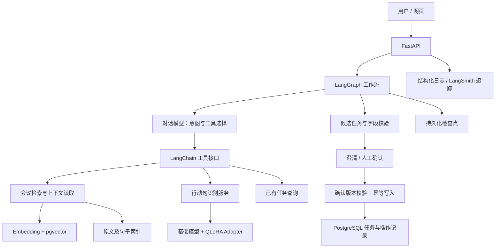

# 项目思路与实施路线

更新日期：2026-10-27。本文描述待实现架构；参数和规模需经数据审计、基线及短程训练确定。

## 1. 总体思路

把模型能力、业务控制和工程服务分开：

- 小模型学习行动句识别，任务窄、监督清楚、便于评估。
- Agent 根据用户需求选择检索、读取、检测和任务查询等工具。
- LangGraph 管理分支、循环、等待用户和恢复。
- 服务端校验决定哪些操作可执行，数据库保存真实任务状态。

会议中的建议是否被正式采纳，需要结合上下文和用户确认。行动句模型是候选证据来源，不是任务批准者。

## 2. 架构



早期先用模拟模型完成服务流程，随后接入真实模型。数据库与向量检索可以共用 PostgreSQL 实例，但业务表、向量表、工作流检查点分别管理。

## 3. 技术选型与理由

| 组件 | 第一版方案 | 用在哪里 |
|---|---|---|
| 应用语言 | Python | 数据处理、服务、评估 |
| 模型/工具接口 | LangChain | 对话模型适配、工具 schema、检索器 |
| 工作流 | LangGraph | 状态、分支、受限工具循环、等待与恢复 |
| 服务 | FastAPI + Pydantic | 类型化输入输出、任务提交、确认与查询 |
| 数据与向量 | PostgreSQL + pgvector | 任务事务、向量检索及元数据过滤 |
| 行动句模型 | Qwen2.5-1.5B-Instruct 起步 | 少量样本验证后 QLoRA |
| 训练 | Transformers + PEFT；TRL 可作为 SFT 封装 | 加载、量化、Adapter 训练、推理 |
| Embedding | CPU 可运行的小型中文/多语言模型 | 离线索引、在线问题向量化，型号待实验 |
| 追踪 | LangSmith + 本地结构化日志 | 工具链、错误、延时、token、成本 |
| 界面 | 简单网页 | 三个页面，不引入重型前端架构 |
| 部署 | 本地应用 + 按需远程模型 | 单用户演示，后续再整理容器配置 |

LangGraph 支持中断等待与恢复，但仍要配置持久化检查点和稳定的会话标识；恢复过程中节点可能重新执行，写操作必须设计幂等。[官方中断说明](https://docs.langchain.com/oss/python/langgraph/interrupts)

pgvector 提供 PostgreSQL 内的向量检索；LangSmith 用于调用链追踪和评估。[pgvector](https://github.com/pgvector/pgvector) · [LangSmith](https://docs.langchain.com/langsmith/observability)

不先锁死全部依赖版本。分别验证 Mac 应用环境和 Linux GPU 训练环境后，保存各自版本清单，避免将训练用 CUDA 依赖装进 Mac 应用环境。

## 4. 三条运行路线

### 4.1 会议问答

用户问题 → 识别会议范围 → 检索片段 → 按需读上下文 → 生成带引用回答 → 检查句子编号。

检索必须按 `meeting_id` 和内容版本过滤。原文、标题和元数据可进入索引；行动项 Gold 标签、标准答案和测试期人工标注不得进入索引。

先以关键词检索作为基线，再比较向量检索。语义相似不等于证据充分，缺少依据时应说明不足。

### 4.2 全场行动项提取

确定会议版本 → 全文分窗口 → 批量调用行动句模型 → 校验输出编号 → 合并去重 → 补读上下文 → 整理候选任务。

不能用 Top-K 检索替代全文覆盖。对每个窗口记录是否完成，任一窗口失败则标记“部分结果”，不声称已提取完整会议。

每个窗口包括可选的上下文区和待预测中心区。目标只计中心区句子，合并后以会议内唯一句子 ID 评估。过长单句单独标记处理，不静默丢弃。

### 4.3 澄清与创建

候选任务 → 校验证据和字段 → 查询潜在重复 → 缺字段则追问 → 用户编辑/确认 → 版本校验 → 事务创建 → 返回任务编号。

Agent 可以决定读取什么信息，但不得跳过确认节点。取消、拒绝和过期候选都不能进入创建工具。

## 5. 工具设计

| 工具 | 输入要点 | 输出要点 | 副作用 |
|---|---|---|---|
| `search_meeting` | meeting_id、query、内容版本 | 片段、句子 ID、得分 | 无 |
| `read_context` | meeting_id、句子 ID、前后范围 | 原始发言及说话人 | 无 |
| `detect_action_items` | meeting_id、指定范围/全文模式 | 预测行动句、覆盖状态、模型版本 | 保存运行结果，不建任务 |
| `list_tasks` | meeting_id、状态等过滤 | 实际任务列表 | 无 |
| `create_tasks` | 服务端确认记录 ID、幂等键 | task_ids、是否复用 | 写数据库 |

候选编辑和确认通过专门 API/界面完成，确认记录由服务端生成。模型传入 `confirmed=true` 不构成有效确认。

限制工具循环次数、单次读取范围、超时时间和输出大小。达到上限返回可解释的未完成状态，而不是无限检索或重试。

## 6. 状态和数据契约

工作流状态至少包含：`thread_id`、`run_id`、`meeting_id`、`source_hash`、用户目标、工具结果引用、候选 ID/版本、缺失字段、确认状态和错误。

候选状态示例：

```text
detected → needs_clarification → awaiting_confirmation → confirmed → created
                       ↘ rejected
来源变更或候选修改 → stale / 重新确认
```

数据库计划保存会议、句子、向量片段、运行记录、候选任务、确认记录、正式任务和操作日志。

关键规则：

- 证据键为 `(meeting_id, source_hash, sentence_id)`，避免只存数字导致跨会议混淆。
- 确认绑定候选版本、内容指纹及操作者的会话身份；单用户演示也要服务端校验。
- 幂等键和候选版本设唯一约束，防止重复确认或恢复执行导致重复任务。
- 相似任务仅提示重复，由用户决定合并；不要根据模糊相似度直接删除。
- 确认记录、任务写入与业务状态在同一事务中处理；检查点重放后也应得到相同结果。
- 不承诺跨系统“恰好一次”。演示中的数据库幂等与事务需要故障测试验证。
- 相对日期需要明确会议日期/时区及用户核对；模型推测不能写成已确认日期。

## 7. 微调实验设计

### 7.1 任务与样本

输入：任务说明、可预测句子范围、带句子编号和说话人的上下文。

输出：仅包含行动句编号的结构化对象。下面是自编示例：

```json
{"action_sentence_ids": [102]}
```

先保存统一的监督数据，再通过基础模型官方 chat template 构造训练输入。只对目标回答部分计算训练损失，padding 不计入损失；具体实现须通过少量样本和标签掩码检查。

训练目标中不出现任务批准、真实 API 执行结果或凭空补充的负责人。

### 7.2 基线与训练

至少建立三组实验：

1. 原模型 + 普通提示词。
2. 原模型 + 在验证集上优化的提示词。
3. 同一基础模型 + QLoRA Adapter，使用匹配的任务定义与输入格式。

记录每组实际提示词。微调前后主对比尽量固定推理模板、解码、输入长度和解析规则，避免把提示词或解码变化的收益算作微调收益。

暂定起步配置：

| 参数 | 初始试验值/范围 | 如何决定 |
|---|---|---|
| 模型 | 1.5B 指令模型 | 先验证标签任务是否可学 |
| 方法 | 4-bit QLoRA | 使用量化基础模型和 LoRA Adapter |
| 样本量 | 约 1,000～3,000 窗口 | 以去重、标签质量和长度为准 |
| 总序列长度 | 1,024～2,048 tokens | 不截掉目标；先测显存 |
| micro batch | 1 起步 | 短程试验后调整 |
| 梯度累积 | 按有效 batch 和吞吐设定 | 不冒充固定最佳值 |
| LoRA rank | 8 或 16 起步 | 先跑一个配置，不大范围搜索 |
| epoch | 1～3 为试验范围 | 依据验证集指标与过拟合决定 |
| 显存优化 | 梯度检查点、受控序列长度 | 记录实际配置和峰值 |

4-bit 权重不代表全部训练内存只占模型参数的四分之一，激活、梯度和临时缓冲仍占空间。先在目标机器跑通，再估正式成本。[PEFT 量化训练说明](https://huggingface.co/docs/peft/developer_guides/quantization)

### 7.3 训练输出

保存 Adapter、tokenizer/chat template 相关信息、基础模型修订号、训练配置、数据哈希、划分清单、环境版本、日志和验证预测。模型卡明确局限和部署位置。

最终选择使用验证集，测试集仅用于冻结方案后的最终报告。测试后继续调参就要承认该测试集已参与开发，并另建独立验证证据。

## 8. 评估体系

### 8.1 行动句模型

- 以 `(meeting_id, sentence_id)` 为唯一判定单位计算 Precision、Recall、F1。
- 先合并窗口预测再计分，避免重叠窗口重复计算。
- 同时报 micro 指标和按会议汇总的 macro 指标，明确无正例会议的处理规则。
- 单独报告 JSON 合法率、编号合法率及无行动项片段误报率。
- 格式错误样本不能直接丢弃后提高 F1；固定解析策略，保留原始输出，分别报格式与内容结果。
- 检查困难负例、否定、暂缓、指代和跨句信息；没有显著提升也如实报告。

### 8.2 任务整理和检索

另建人工审核集，评估负责人、日期、任务描述的证据支持，未知值处理和引用定位。检索评估使用自建问题与证据标注，不把行动句标签等同于所有问答的检索 Gold。

如果只训练行动句检测，不能把对话模型完成的摘要、负责人抽取成绩当作该 Adapter 的成绩。

### 8.3 系统行为

必须覆盖：用户拒绝、缺字段、来源更新、草稿修改、重复提交、服务中断恢复、工具超时、窗口部分失败、错误证据编号、会议文本诱导工具调用。

“未经确认写入为零”“相同确认不重复创建”是验收要求，不是当前已实现结果。用确定性测试验证；不要只让大模型给自己打分。

### 8.4 运行成本与追踪

每个 run 记录模型/Adapter 版本、检索配置、工具名、耗时、重试和错误类型。支持时采集 token 用量；估算成本明确标注，供应商计费不能用逻辑调用次数替代。

正式演示记录任务总耗时；样本足够时统计 p50/p95。对比准确率改善与延时增加，不只报单一成功率。

## 9. 一步一步建出来

| 阶段 | 主要工作 | 交付物 | 进入下一阶段的条件 |
|---|---|---|---|
| P0 数据可用性 | 少量下载、解析、标签和许可核验 | 数据审计、来源清单、字段样例 | 确定有可用行动标签，未把缺失当负例 |
| P1 数据与基线 | 会议级划分、窗口化、普通/优化提示词基线 | 冻结划分、数据校验、基线预测和指标 | 数据无明显泄漏、评估可重复 |
| P2 微调 | 单卡短程测试、正式 QLoRA、验证选择 | Adapter、配置、模型卡、前后对比 | 训练能复现，收益和退化有解释 |
| P3 文本与任务服务 | 会议读取、候选数据结构、任务 CRUD、确认事务 | FastAPI、数据库、离线服务测试 | 用模拟结果能完成创建，拒绝与重复正确处理 |
| P4 RAG 与 Agent | 索引、检索工具、LangGraph、真实模型适配 | 可恢复工作流、引用和工具轨迹 | 明确区分问答检索和全场提取，真实调用可定位错误 |
| P5 产品联调 | 三个页面、微调模型实际接入、异常反馈 | 可操作演示、真实运行记录 | 端到端和故障案例通过，模拟与实时结果标记清楚 |
| P6 交付 | 环境锁定、启动说明、评估汇总和演示脚本 | 可复现项目包与面试材料 | 干净环境或明确环境限制下重现核心流程 |

P3 的接口和界面可在等待 GPU 时用模拟结果开发，但正式成果必须经过真实微调模型联调。各阶段通过后再扩大范围，不一次性建所有基础设施。

P2 若无收益，先查标签、窗口、模板和评估，不立即升级大模型或增加 GPU。失败实验也保留为证据，不能换一批更容易的数据冒充改进。

## 10. 建议目录结构

以下目录为后续实施规划，当前仅创建 `docs/project-plan/`：

```text
meeting_assistant/
├── docs/project-plan/          # 本轮规划文档
├── data/
│   ├── raw/alimeeting4mug/     # 下载原件，只读保留
│   ├── processed/             # 标准会议、窗口、训练样本
│   ├── splits/                # 会议级冻结划分
│   └── annotations/           # 补充字段标注，区分开发/测试
├── app/
│   ├── api/                   # HTTP 接口
│   ├── services/              # 检测、任务、确认服务
│   ├── agent/                 # 图状态、节点、工具
│   ├── retrieval/             # 索引与检索
│   ├── storage/               # 业务表与事务
│   └── web/                   # 简单界面
├── training/                  # GPU 训练、适配器推理与配置
├── evaluation/                # 模型、检索和系统评估代码
├── tests/                     # 核心行为测试
└── outputs/
    ├── audits/                # 数据审计
    ├── models/                # Adapter 与模型卡
    ├── evaluations/           # 正式指标、预测与错误分析
    └── demos/                 # 独立演示记录
```

原始数据、模型权重、Token、运行数据库和含个人数据的日志不默认进入 Git。首次提交前按许可和实际内容确定忽略规则，不将数据许可自动套到全部代码上。

## 11. 当前未定事项与决策时机

| 未定事项 | 何时决定 | 不确定时的做法 |
|---|---|---|
| 实际数据划分及标签可用性 | P0 | 核验后再定样本量，不凭网页总量估算 |
| Mac 内存与部署兼容性 | 本地环境安装前 | 先做文本审计，不启动重型服务 |
| 对话 API、Embedding 型号 | P1/P4 的小样本试验 | 固定一个可用基线，避免频繁换栈 |
| GPU 型号、租机预算 | P2 前 | 先估数据量和长度，短程测速后正式训练 |
| 负责人/日期标签规则 | 补充标注前 | 明确未知、用户补充和原文事实的区别 |
| 数值验收目标 | 基线后、正式调优前 | 不预先承诺 F1；业务不变量单独测试 |

当前执行入口是 P0：获取少量有行动项标签的会议原件并审计。无需先决定所有扩展功能。
